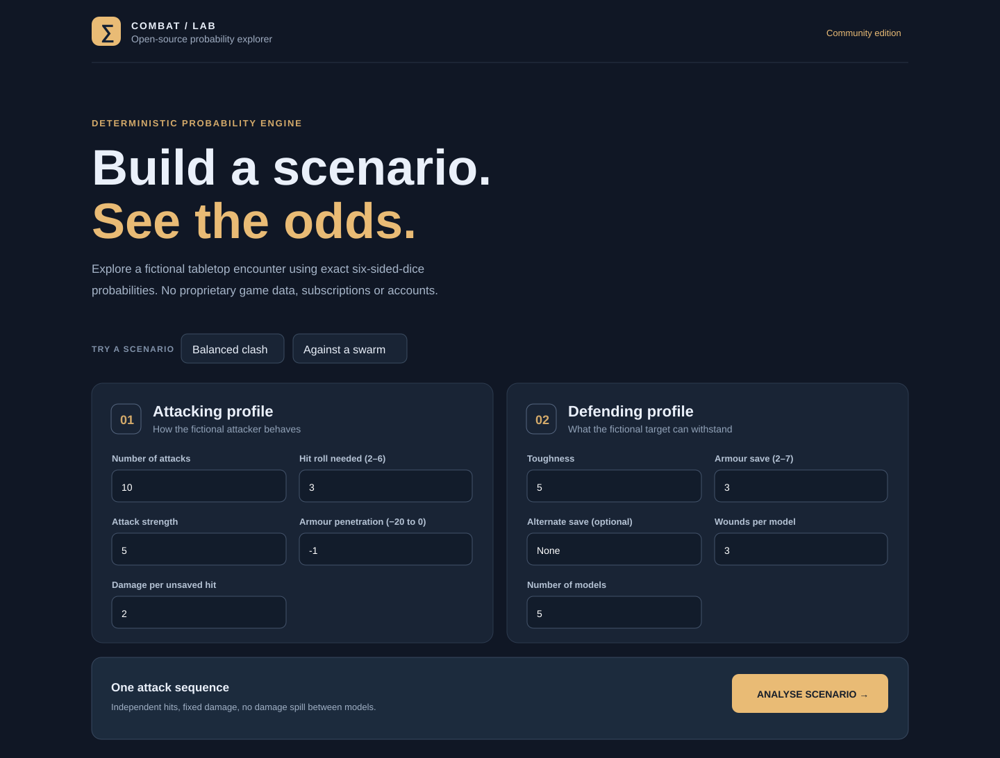
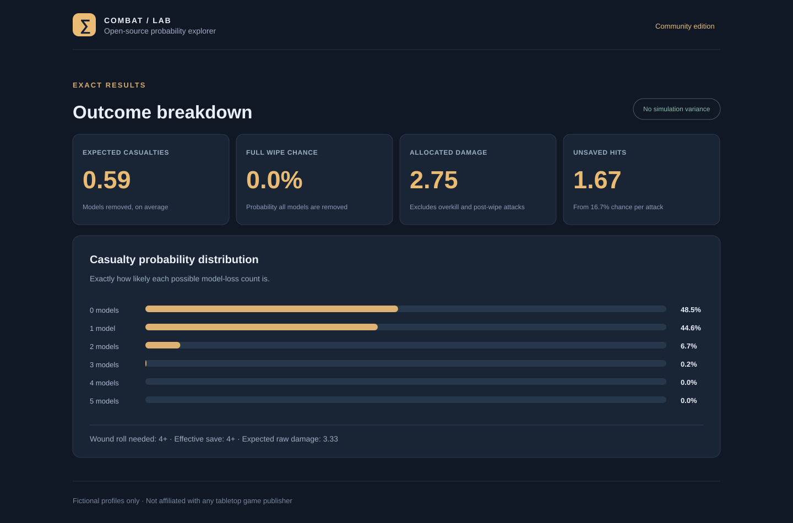
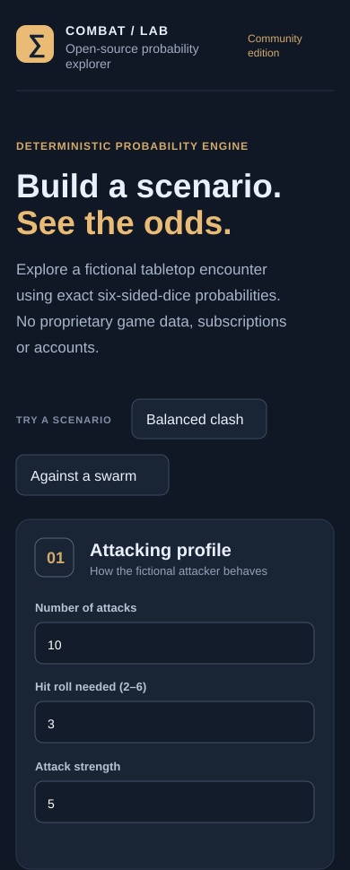

# Combat Probability Lab

**A small, open-source, fictional tabletop combat calculator.** Built with .NET 10, React 19, TypeScript and exact binomial probabilities. Published in [Tac40kApp](https://github.com/luke1conroy/Tac40kApp).

> **Project status: development paused.** I built this for fun and to explore probability modelling, but I'm no longer pursuing it as a product because there are already several established alternatives and I can't justify the ongoing maintenance time. **Anyone is welcome to use, fork or extend this code under the MIT licence.** I won't be actively maintaining it or guaranteeing support. [Read my full note](PROJECT_STATUS.md).

This is a deliberately **separate, reduced public edition** created from lessons learned building a private tabletop-combat hobby project. It is **not** the complete original game-specific application, does **not** include any Warhammer/BSData catalogue or other third-party game profiles, and has no affiliation with any game publisher.

## Interface previews

These are **illustrative UI previews based on the frontend layout**, not verified screenshots of a running app. The sample results use fictional profiles. [About these previews](docs/previews/README.md).

| Scenario builder | Analysis results |
|:--:|:--:|
|  |  |

**Responsive layout**



## What works

- Generic D6 hit, wound and armour-save resolution.
- Fixed-damage attack sequences, where overkill on a single defender does not spill into the next model.
- Exact probability distribution of casualties, average allocated damage, wipe chance and expected unsaved attacks.
- Plain-language outcome summary: most likely number of kills, chance of at least one kill, average survivors and wasted damage.
- The **most likely kill count** is the most probable integer outcome, not the average rounded to an integer. Ties prefer the lower count.
- Responsive React UI with two entirely fictional examples.
- Minimal ASP.NET Core API and xUnit tests.
- No accounts, database, telemetry or deployment credentials.

## Quick start

Prerequisites: [.NET SDK 10](https://dotnet.microsoft.com/download) and [Node.js 22+](https://nodejs.org/).

Terminal 1 (from the repository root):

```bash
dotnet run --project src/CombatProbabilityLab.Api --urls http://localhost:5080
```

Terminal 2:

```bash
cd web
npm install
npm run dev
```

Open `http://localhost:5173` and select **Analyse Scenario**. Vite proxies `/api` to the local .NET API.

Check the API directly:

```bash
curl http://localhost:5080/health
curl -X POST http://localhost:5080/api/analyse \
  -H 'Content-Type: application/json' \
  -d '{"attack":{"attacks":10,"hitOn":3,"strength":5,"armourPenetration":-1,"damage":2},"defender":{"toughness":5,"armourSave":3,"invulnerableSave":null,"woundsPerModel":3,"modelCount":5}}'
```

### Tests

```bash
dotnet test tests/CombatProbabilityLab.Tests
cd web && npm run build && npm run test
python3 scripts/check_publication.py
```

## How it works

The core uses the same kind of **deterministic probability modelling** as the private project's original combat maths, presented here as a fresh, independently usable generic example:

1. Compute `P(unsaved attack) = P(hit) × P(wound) × P(failed save)`.
2. Generate the exact binomial distribution across the number of unsaved attacks.
3. For each possible unsaved-attack count, allocate fixed damage in sequence to identical defending models. Damage above the model's remaining wounds is wasted, and attacks after the entire group dies do no allocated damage.
4. Weight casualties, effective damage and complete-wipe outcomes by their exact probabilities.

All attackers are independent and identical. This is **not a full combat-rules engine**: no buffs, rerolls, critical effects, random damage, varied equipment, attached units, position-dependent rules or current official game statistics. Results are teaching estimates under the documented simplified model.

## Structure

- `src/CombatProbabilityLab.Core/` — pure C# probability engine and input records.
- `src/CombatProbabilityLab.Api/` — minimal ASP.NET Core API and local-only CORS defaults.
- `web/` — React 19 / TypeScript / Vite UI with focused scenario/results components, feature-specific CSS, and Vitest component tests.
- `tests/` — xUnit unit tests.
- `docs/PUBLISHING.md` — separate-public-repository release checklist.

## Contributing and maintenance

This project is made available **as-is** and is **not actively maintained**. You are welcome to use it, fork it and propose improvements, but I cannot promise reviews, support or future updates. See [PROJECT_STATUS.md](PROJECT_STATUS.md) and [CONTRIBUTING.md](CONTRIBUTING.md).

## Licence and third-party rights

The original code in this clean edition is licensed under the [MIT License](LICENSE). That licence applies **only to this repository's original material**, not to any other tabletop franchise, source dataset, marks or rules. Do not add externally sourced game data, branded names, official artwork or copyrighted rule descriptions without appropriate permissions.

See [NOTICE.md](NOTICE.md) and [docs/PUBLISHING.md](docs/PUBLISHING.md).
